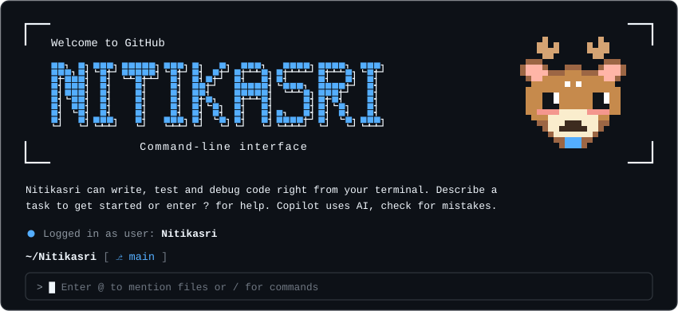

<div align="center">
  <br/>
  <a href="#-software-engineering--systems"></a>
  <a href="#-software-engineering--systems"></a>
  <a href="#-applied-ai--data-science"></a>
  <a href="#-software-engineering--systems"></a>
  <a href="#-software-engineering--systems"></a>
  <a href="#-software-engineering--systems"></a>
  <a href="#-software-engineering--systems"></a>
</div>

---

### ☕ `whoami.java`

```java
package dev.nitikasri;

public record Engineer(
    String name,
    String degree,
    String year,
    String corePassion,
    String[] favoriteTech,
    String currentFocus,
    String realityCheck
) {
    public static Engineer initialize() {
        return new Engineer(
            "Nitikasri",
            "B.Tech in Artificial Intelligence & Data Science",
            "Third Year (Class of 2027)",
            "Robust Object-Oriented Systems & Clean Java Architecture",
            new String[] { "Java", "Python", "FastAPI", "Spring Boot", "TypeScript", "PostgreSQL", "Docker" },
            "Engineering campus network automation, edge safety IoT, and end-to-end ML pipelines",
            "coding while managing to stay alive by a thread."
        );
    }
}
```

---

### 🎯 Current Mission & Focus

I am an AI & Data Science undergraduate who bridges the gap between mathematical models and practical software engineering. While my degree focuses on data and intelligent systems, my engineering heart belongs to **Java, resilient backend architectures, and production-minded systems.**

- 🌐 **Campus Network Observability**: Architecting configuration drift detection, hierarchical AST tree normalization, and safe, reversible CLI remediation for distributed network switches ([`campus-drift`](https://github.com/NitikasriJeyanAchary0109/campus-drift)).
- 🛡️ **Edge IoT & Safety Systems**: Integrating Jetson-based computer vision PPE turnstiles, ESP32 biometric wearables, multi-gas telemetry grids, and 3D digital twins ([`mineos`](https://github.com/NitikasriJeyanAchary0109/mineos)).
- 🧠 **Applied ML & Diagnostics**: Translating statistical datasets into predictive diagnostic engines with interactive Streamlit GUIs ([`air_quality_index`](https://github.com/NitikasriJeyanAchary0109/air_quality_index), [`student_stress_predictor`](https://github.com/NitikasriJeyanAchary0109/student_stress_predictor)).
- ☕ **Deepening Enterprise Java**: Mastering Spring Boot 3, RESTful microservices, and object-oriented design patterns with robust testing ([`NextDoorHelp`](https://github.com/NitikasriJeyanAchary0109/NextDoorHelp)).

---

### 🧠 Applied AI & Data Science

My approach to machine learning prioritizes data integrity, rigorous validation, and reproducible pipelines over black-box guesswork.

```
┌──────────────┐     ┌──────────────┐     ┌──────────────────────┐     ┌─────────────────────┐     ┌─────────────────┐
│   Raw Data   │ ──> │ Data Cleaning│ ──> │ Feature Engineering  │ ──> │ Cross-Validation    │ ──> │ Deployment / UI │
│ CSV / Sensor │     │ & Imputation │     │ Scaling & Selection  │     │ K-Fold & Evaluation │     │ Streamlit / API │
└──────────────┘     └──────────────┘     └──────────────────────┘     └─────────────────────┘     └─────────────────┘
```

#### Demonstrated Areas:
- **Environmental & Climate Modeling**: Real-time atmospheric PM2.5 and AQI estimation using serialized Scikit-Learn regressors with interactive web telemetry.
- **Healthcare & Diagnostic Classifiers**: Predictive risk analysis using clinical attributes across oncology, cardiology, and metabolic datasets ([`cancer_prediction`](https://github.com/NitikasriJeyanAchary0109/cancer_prediction), [`heart_disease-`](https://github.com/NitikasriJeyanAchary0109/heart_disease-), [`diabetes_predictor`](https://github.com/NitikasriJeyanAchary0109/diabetes_predictor)).
- **Local LLMs & GenAI**: Integrating local Llama 3 models via Ollama for private, on-device financial guidance without external API dependencies ([`ConsumerLiterarcyTrack`](https://github.com/NitikasriJeyanAchary0109/ConsumerLiterarcyTrack)).
- **Behavioral & Unsupervised Clustering**: Customer segmentation via K-Means clustering and demographic spending patterns ([`mall_spending`](https://github.com/NitikasriJeyanAchary0109/mall_spending)).

---

### 🛠️ Technical Arsenal

<table>
  <tr>
    <td width="22%"><strong>Core Languages</strong></td>
    <td>
      
      
      
      
      
      
    </td>
  </tr>
  <tr>
    <td><strong>AI & Machine Learning</strong></td>
    <td>
      
      
      
      
      
      
    </td>
  </tr>
  <tr>
    <td><strong>Backend & Systems</strong></td>
    <td>
      
      
      
      
      
      
    </td>
  </tr>
  <tr>
    <td><strong>Databases & Storage</strong></td>
    <td>
      
      
      
      
    </td>
  </tr>
  <tr>
    <td><strong>Frontend & Visualization</strong></td>
    <td>
      
      
      
      
      
    </td>
  </tr>
  <tr>
    <td><strong>DevOps & Tooling</strong></td>
    <td>
      
      
      
      
      
      
    </td>
  </tr>
</table>

---

### 📦 Curated Project Vault

A selection of real systems engineered to solve concrete problems.

#### 1. [Campus-Drift](https://github.com/NitikasriJeyanAchary0109/campus-drift) — Automated Network Configuration Drift Detection & Remediation Engine
> *A production-style monolith-first observability platform monitoring campus-scale network hardware against defined baselines.*

- **Problem**: Network misconfigurations and unrecorded changes across labs, hostels, and lecture halls lead to security blindspots and silent outages.
- **Architecture**:
  - FastAPI backend communicating with Cisco/network switches via Netmiko/SSH.
  - Custom AST normalizer translating flat CLI configs into hierarchical trees.
  - Custom tree-diff engine paired with a rule-weighted risk & severity scoring algorithm.
  - Safe, reversible CLI remediation engine using Jinja2 templates, protected by strict RBAC, automated pre-change snapshots, and post-change verification.
  - React + TypeScript SPA dashboard backed by PostgreSQL, Redis queues, and APScheduler workers.
- **Tech Stack**: `FastAPI` • `Python` • `PostgreSQL` • `Redis` • `Netmiko` • `React` • `TypeScript` • `Docker Compose`

---

#### 2. [MineOS](https://github.com/NitikasriJeyanAchary0109/mineos) — Real-Time Subterranean Mining Safety & Environmental OS
> *An industrial IoT, edge computer-vision, and digital twin operating system for subterranean worker safety.*

- **Problem**: Manual turnstiles fail to catch missing PPE; toxic gases ($CH_4$, $CO$) build up unnoticed; and subterranean worker falls frequently go undetected due to poor shaft connectivity.
- **Architecture**:
  - Edge turnstile computer vision model running on Nvidia Jetson for automated PPE compliance verification before portal access.
  - ESP32 wearable sensor firmware streaming $SpO_2$, heart rate, and MPU6050 accelerometer impact/fall detection.
  - Multi-gas atmospheric sensor grid (MQ-2, MQ-4, MQ-7, MQ-9, flame detectors) mapped across mine sectors.
  - Offline-resilient local buffering engine that caches telemetry during link outages and flushes upon reconnection.
  - Interactive 3D Digital Twin control room rendered with Three.js / React Three Fiber, paired with a companion Android mobile app (`MineOS.apk`) built with Capacitor.
- **Tech Stack**: `TypeScript` • `React Three Fiber` • `Express.js` • `Supabase` • `Capacitor Android` • `Edge CV` • `IoT`

---

#### 3. [SpareChange AI (ConsumerLiterarcyTrack)](https://github.com/NitikasriJeyanAchary0109/ConsumerLiterarcyTrack) — Micro-Savings & Local LLM Financial Advisor
> *Automated micro-savings with privacy-first financial literacy explanations powered by an on-premise LLM.*

- **Problem**: College students struggle to understand complex personal finance and build early savings habits without their transaction data being harvested.
- **Architecture**:
  - Automated micro-savings engine rounding up daily transactions into structured savings goals.
  - Local AI inference pipeline using Ollama running Llama 3 to explain budget impacts and financial advice in plain language without third-party cloud data exposure.
  - Multi-stage Dockerized FastAPI backend with Google OAuth 2.0 authentication and educator/advisor companion views.
  - Automated SSL/HTTPS edge reverse proxy configured via Caddy and Let's Encrypt.
- **Tech Stack**: `FastAPI` • `Python` • `React` • `PostgreSQL` • `Ollama / Llama 3` • `Caddy` • `Docker Compose`

---

#### 4. [NextDoorHelp](https://github.com/NitikasriJeyanAchary0109/NextDoorHelp) — Community Assistance & Neighborhood Services Platform
> *Connecting neighbors for micro-tasks, urgent home repairs, and companionship.*

- **Problem**: Fragile community coordination makes finding trusted, local help for quick errands or elderly companionship unnecessarily difficult.
- **Architecture**:
  - Spring Boot 3.5 RESTful backend applying clean Object-Oriented principles and layered service architecture.
  - Structured domain modeling for user identities, task lifecycle states, and localized service discovery.
  - Maven-managed dependency lifecycle with modular frontend integration.
- **Tech Stack**: `Java` • `Spring Boot 3.5` • `Maven` • `RESTful APIs` • `Frontend`

---

#### 5. [Applied ML & Predictive Diagnostics Suite](https://github.com/NitikasriJeyanAchary0109?tab=repositories) — Interactive Model Sandbox
> *A collection of end-to-end machine learning implementations with feature engineering and Streamlit web interfaces.*

| Project | Target Problem | Model & Technique | Interface |
|---|---|---|---|
| [**air_quality_index**](https://github.com/NitikasriJeyanAchary0109/air_quality_index) | Real-time atmospheric PM2.5 / AQI prediction | Supervised Regression & Feature Scaling | `Streamlit App` |
| [**student_stress_predictor**](https://github.com/NitikasriJeyanAchary0109/student_stress_predictor) | Multi-tier student stress level classification | K-Nearest Neighbors (KNN) Classifier | `Streamlit App` |
| [**cross_validation**](https://github.com/NitikasriJeyanAchary0109/cross_validation) | Model variance analysis & overfitting mitigation | K-Fold Cross-Validation Pipeline | `Streamlit App` |
| [**cancer_prediction**](https://github.com/NitikasriJeyanAchary0109/cancer_prediction) | Clinical diagnostic classification for early detection | Binary Classification & Feature Selection | `Python / Notebook` |
| [**heart_disease-**](https://github.com/NitikasriJeyanAchary0109/heart_disease-) | Cardiovascular risk evaluation from patient vitals | Supervised Classification Pipeline | `Python / Scikit-Learn` |
| [**mall_spending**](https://github.com/NitikasriJeyanAchary0109/mall_spending) | Retail consumer behavior segmentation | Unsupervised K-Means Clustering | `Pandas / Matplotlib` |

---

### 📊 Telemetry & Activity

<div align="center">


</div>

---

### 💬 Closing Signature

```java
try {
    while (!world.isSolved()) {
        nitikasri.learn();
        nitikasri.build();
    }
} catch (OutOfMemoryError e) {
    nitikasri.grabCoffee();
    // Still learning. Still building. Somehow still compiling.
}
```

<div align="center">

*Thanks for stopping by! Whether you want to discuss Java internals, robust distributed systems, or the chaotic beauty of machine learning — let's build something remarkable.*

</div>
